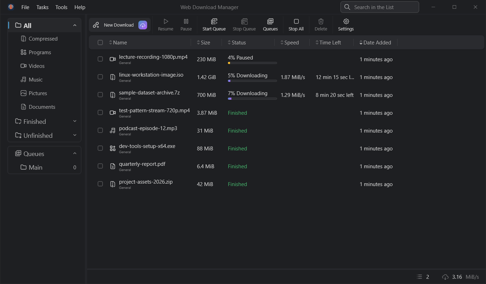
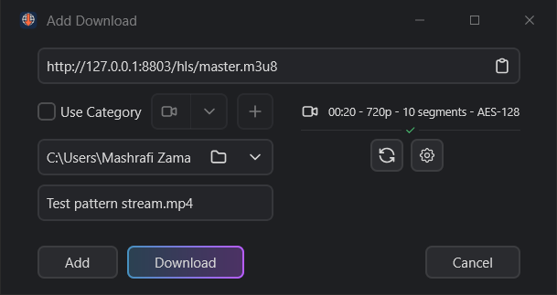
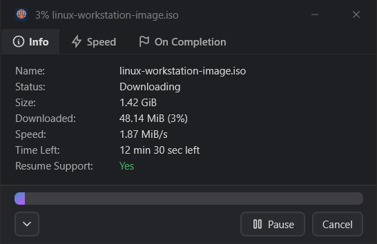
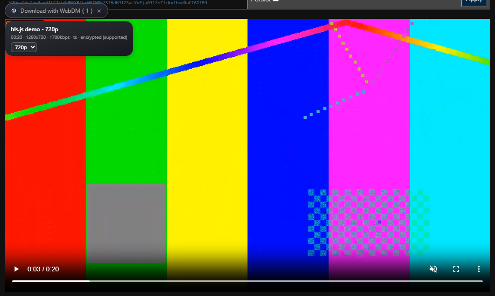

<div align="center">
  <a href="https://github.com/Mashrafi-Zaman/webdm">
    
  </a>
</div>
<h1 align="center">WebDM — Web Download Manager</h1>
<p align="center"><b>A fast Windows download manager that also catches the videos your browser plays.</b></p>
<p align="center">
  <a href="https://github.com/Mashrafi-Zaman/webdm/releases/latest"></a>
  <a href="https://github.com/Mashrafi-Zaman/webdm/releases"></a>
  <a href="LICENSE"></a>
  
</p>

<a href="https://github.com/Mashrafi-Zaman/webdm">
  
</a>

## Introduction

WebDM is a desktop download manager for Windows 10 and 11 (x64). It splits files into several connections, resumes
interrupted downloads, and works with a browser extension that sends downloads and video streams from Chrome, Edge,
Brave or Opera straight to the app. HLS streams, players that load picture and sound separately, and pages on video
sites end up as a single playable file.

WebDM is a modified fork of [AB Download Manager](https://github.com/amir1376/ab-download-manager) by amir1376
(Apache License 2.0). It keeps its own name, data folder, port and app ID, so both can be installed side by side.
Only Windows x64 is built and supported.

## Features

**Downloading**
- Multiple connections per file, pause and resume (also after a restart or a lost connection)
- Queues with a scheduler (start/stop times, days of the week) and a limit on parallel downloads
- Speed limiter, globally and per download
- Categories that sort files into folders (Compressed, Programs, Videos, Music, Pictures, Documents)
- Per-host settings, proxy support, file checksums, batch downloads
- Silent add from the browser, with automatic `name (1).ext` renaming for duplicates

**Video**
- HLS (`.m3u8`) with a quality choice, AES-128 encrypted streams, fMP4 and live recordings, merged into one file
- Streams that a page plays from numbered segments without a playlist are rebuilt into one file
- DASH-style players that fetch video and audio as separate files (for example Facebook): both downloaded in
  parallel parts and merged
- Video sites through yt-dlp: YouTube, Facebook, Instagram, X, TikTok, Vimeo and many more, with a quality list
- ffmpeg (LGPL build) and yt-dlp are included; **Settings → Tools** updates them and can convert `.ts` to `.mp4`
  (stream copy, no re-encoding)

**Browser and desktop**
- Browser extension for Chromium browsers: captures downloads, adds *Download with WebDM* to the right-click menu,
  and shows a floating *Download with WebDM* button on video players, also inside iframes
- Drag and drop links or `.txt` files of links onto the main window, or onto the optional floating drop target
- Local HTTP API for other tools (`/add`, `/capabilities`, `/queues`, ...; see [REST-API.yml](REST-API.yml)) and a
  command-line tool (`WebDMCli`)
- Several dark and light themes, system tray, start with Windows, 28 languages (translations from AB Download Manager)

**Planned**
- Code-signed installer, so Windows SmartScreen doesn't warn on first run
- Automatic extension updates (today: unzip the new version over the old folder)

DRM-protected streams (Widevine, PlayReady, FairPlay) are not supported. See the [legal note](#legal-note).

## Screenshots

<div align="center">
  
  <br><em>Main window</em><br><br>
  
  
  <br><em>Add Download for an HLS stream (quality, segments, encryption) · progress window</em><br><br>
  
  <br><em>The browser extension on the hls.js demo page (a locally generated test stream)</em>
</div>

## Installation

1. Download one of these from [Releases](https://github.com/Mashrafi-Zaman/webdm/releases/latest):
   - `WebDM_<version>_windows_x64.exe`: the installer (recommended). It installs for your user only, into
     `%LOCALAPPDATA%\WebDM`, and doesn't need administrator rights.
   - `WebDM_<version>_windows_x64.zip`: the portable version. Unzip it anywhere and run `WebDM.exe`.
2. **SmartScreen:** the builds are not code-signed yet, so Windows may show "Windows protected your PC". Click
   **More info → Run anyway**. You can check the file against `SHA256SUMS.txt` from the release first
   (`Get-FileHash .\WebDM_<version>_windows_x64.exe`).
3. **First run:** WebDM starts with an empty list and the default categories. Your settings and download list are kept
   in `%USERPROFILE%\.webdm`; downloads go to your Downloads folder unless you change it in Settings.
4. **ffmpeg and yt-dlp** are already included. If a video site stops working, open **Settings → Tools** and click
   *Download or update yt-dlp*; *Download or update ffmpeg* does the same for ffmpeg (both downloads are checked
   against their published SHA-256 checksums).

> ⚠️ WebDM is only published in this repository. Copies from anywhere else may not be safe.

## Browser extension

The **WebDM Integration** extension is for Chromium browsers (Chrome, Edge, Brave, Opera). Firefox is not supported.

1. Download `WebDM_Extension_<version>_chromium.zip` from
   [Releases](https://github.com/Mashrafi-Zaman/webdm/releases/latest).
2. Unzip it to a folder you will keep (the browser loads it from there on every start).
3. Open `chrome://extensions` (or `edge://extensions`, `brave://extensions`, `opera://extensions`).
4. Turn on **Developer mode**, click **Load unpacked** and pick the unzipped folder.
5. Click the extension's toolbar icon: with WebDM running it shows **Connected**.

**Why not a `.crx`?** On Windows, Chrome and Edge block `.crx` extensions that don't come from their own web store,
and WebDM isn't published there. *Load unpacked* is the supported way to run an extension from outside the store.
More details, the permissions and the privacy notes are in the
[extension repository](https://github.com/Mashrafi-Zaman/webdm-extension).

## Usage

- **Add a link:** click **New Download** (`Ctrl+N`), or copy a link and press `Ctrl+V` in the main window. Pick the
  folder and name, then **Download** (start now) or **Add** (keep it in the list or a queue).
- **Download a video from a page:** play the video; the floating **Download with WebDM** button appears on the player.
  Open it, choose a quality and click the entry; WebDM opens the Add Download dialog. On video sites, choose
  **Download with WebDM (best)** to let yt-dlp read the page.
- **Quality:** for HLS master playlists and video sites, the Add Download dialog lists the available qualities; the
  extension's list has a quality selector per video.
- **Drag and drop:** drag a link from the browser, or `.txt` files with one link per line, onto the main window.
  For a small always-on-top target, turn on **Floating drop target** in the tray menu.
- **Queues and scheduler:** **Queues** in the toolbar; set start/stop times and how many downloads run at once.

## Build from source

Requirements: Windows 10/11 x64, Git, the [JetBrains Runtime](https://github.com/JetBrains/JetBrainsRuntime/releases)
**JBR 25 SDK** (`JAVA_HOME` pointing to it) and [NSIS](https://nsis.sourceforge.io) 3 for the installer.

```bash
git clone https://github.com/Mashrafi-Zaman/webdm.git
cd webdm
set SKIP_ANDROID_BUILD=true
gradlew.bat createReleaseFolderForCi
```

The installer and the portable zip are written to `build/ci-release/binaries`. The build downloads the bundled ffmpeg
and yt-dlp and checks their checksums, so it needs internet access.

The extension lives in [webdm-extension](https://github.com/Mashrafi-Zaman/webdm-extension) (Node.js 22):

```bash
npm ci
npm run pack:chrome    # dist/chrome (unpacked) and dist/chrome.zip
```

Releases are built by the [Publish workflow](.github/workflows/publish.yml) when a `v*` tag is pushed.

## FAQ and troubleshooting

**The download button doesn't show up on a page.**
Reload the page after installing or updating the extension. Check that WebDM isn't turned off for that site in the
extension options (*Popular sites* and the blocked-URL list). Some players only request the stream once you press
play.

**The extension says it can't reach the app.**
WebDM must be running (it can stay in the tray). The extension and the app must use the same port: 15515 by default,
see **Settings → Browser Integration** in the app and the port in the extension options. A firewall or another program
on that port can also block it.

**A DRM-protected video (Netflix, Disney+, Spotify, ...) won't download.**
That's intended: WebDM doesn't support Widevine, PlayReady or FairPlay and never will.

**YouTube or another site stopped working.**
Sites change often. Update yt-dlp in **Settings → Tools → Download or update yt-dlp**. For videos that need a login,
turn on *Use browser cookies for video sites* there.

**Can I keep AB Download Manager installed?**
Yes. WebDM uses its own install folder, data folder (`.webdm`), port (15515), native messaging host (`com.webdm.app`)
and registry keys. Install only one browser extension per browser, though, or both will try to capture downloads.

## Legal note

WebDM is a general download tool. Only download content you have the right to download, and respect copyright law and
each website's terms of service. WebDM doesn't circumvent DRM and doesn't help to; encrypted streams are only supported
when the key is openly provided by the stream itself (HLS AES-128).

## Contributing and bug reports

Bugs and ideas: [GitHub Issues](https://github.com/Mashrafi-Zaman/webdm/issues). Before sending a pull request, please
read the [contributing guide](CONTRIBUTING.md).

| Repository                                                                     | Description                   |
|--------------------------------------------------------------------------------|-------------------------------|
| [WebDM](https://github.com/Mashrafi-Zaman/webdm) (you are here)                | The desktop app (Windows x64) |
| [WebDM Integration](https://github.com/Mashrafi-Zaman/webdm-extension)         | The browser extension         |

## Credits and license

WebDM is licensed under the [Apache License 2.0](LICENSE); see also [NOTICE](NOTICE).

- Based on [AB Download Manager](https://github.com/amir1376/ab-download-manager) and its
  [browser integration](https://github.com/amir1376/ab-download-manager-browser-integration) by amir1376 (Apache 2.0).
  WebDM is not affiliated with or endorsed by the AB Download Manager project. Its translators are credited in the app
  (Help → Meet the translators).
- [FFmpeg](https://ffmpeg.org) is included as a separate program, as an LGPL-2.1-or-later build from
  [BtbN/FFmpeg-Builds](https://github.com/BtbN/FFmpeg-Builds); its license and source location are installed next to
  `ffmpeg.exe`. FFmpeg is a trademark of Fabrice Bellard.
- [yt-dlp](https://github.com/yt-dlp/yt-dlp) is included as a separate program under the Unlicense.
- The open-source libraries used by the app and their licenses are listed in Help → View the Open-Source licenses.
