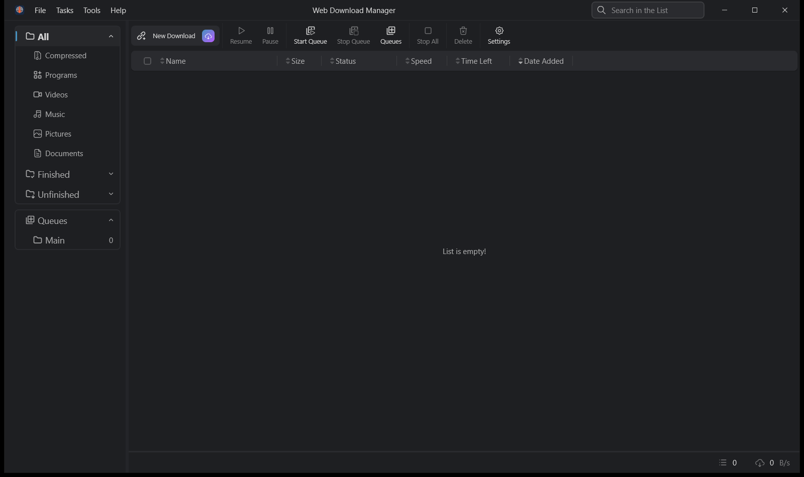

<div align="center">
  <a href="https://github.com/Mashrafi-Zaman/webdm" target="_blank">
    
  </a>
</div>
<h1 align="center">WebDM — Web Download Manager</h1>
<p align="center">
    <a href="https://github.com/Mashrafi-Zaman/webdm/releases/latest"></a>
</p>

<a href="https://github.com/Mashrafi-Zaman/webdm" target="_blank">
    
</a>

## Introduction

[AB Download Manager](https://abdownloadmanager.com) is a desktop app that helps you manage and organize your downloads more efficiently than ever before.

## Features

- ⚡️ Faster Download Speed
- ⏰ Queues and Schedulers
- 🌐 Browser Extensions
- 💻 Multiplatform (Android / Windows / Linux / Mac)
- 🌙 Multiple Themes (Dark/Light/Black and more) with modern UI
- ❤️ Free and Open Source

Please visit [Project Website](https://abdownloadmanager.com) for more info.

## Installation

<a href="https://github.com/amir1376/ab-download-manager/releases/latest"></a>

### Download and Install the App

<a href="https://abdownloadmanager.com"></a>
<a href="https://github.com/amir1376/ab-download-manager/releases/latest"></a>

#### Installation script (Linux)

The recommended way to install the app on Linux

```bash
bash <(curl -fsSL https://raw.githubusercontent.com/amir1376/ab-download-manager/master/scripts/install.sh)
```

#### Winget or Scoop (for Windows)

**winget**:

```bash
winget install amir1376.ABDownloadManager
```

**scoop**:

```bash
scoop install extras/abdownloadmanager
```

#### Homebrew (for macOS & Linux)

```bash
brew tap amir1376/tap && brew install --cask ab-download-manager
```

> ⚠️ **Warning:** This software is NOT on Google Play or other app stores unless listed here. Any version **claiming to be or related to this project** should be considered SCAM and UNSAFE.

For alternative installation methods, uninstallation instructions, and more details, please refer to the [wiki](https://github.com/amir1376/ab-download-manager/wiki/) page.

### Browser Extensions

You can install the **WebDM Integration** browser extension to integrate the app with your browser.
It is not in the Chrome Web Store or Firefox Add-ons yet; build it from
[Mashrafi-Zaman/webdm-extension](https://github.com/Mashrafi-Zaman/webdm-extension) and load it unpacked.

## Screenshots

<div align="center">
  
</div>

## Community

- 📢 [Telegram Channel](https://t.me/abdownloadmanager) – News, announcements, and release updates.
- 💬 [Telegram Group](https://t.me/abdownloadmanager_discussion) – Get help, report bugs, suggest features, and discuss
  the project with the community.

## Repositories And Source Code

There are multiple repositories related to the **AB Download Manager** project:

| Repository                                                                                 | Description                                                                   |
|--------------------------------------------------------------------------------------------|-------------------------------------------------------------------------------|
| [Main Application](https://github.com/amir1376/ab-download-manager) (You are here)         | Contains the  **Application** that runs on your  **device**                   |
| [Browser Integration](https://github.com/amir1376/ab-download-manager-browser-integration) | Contains the **Browser Extension** to be installed on your  **browser**       |
| [Website](https://github.com/amir1376/ab-download-manager-website)                         | Contains the **AB Download Manager** [website](https://abdownloadmanager.com) |

I've spent a lot of time to create this project.

If you like my work, please consider giving it a ⭐ — thanks! ❤️

## Bug Report

If you notice any bugs in the source code, please report them via the `GitHub Issues` section.

## Build From Source

To compile and test the desktop app on your local machine,
follow these steps:

1. Clone the project.
2. Download and extract the [JBR](https://github.com/JetBrains/JetBrainsRuntime/releases), and make it available by either:
    
    - Adding it to your `PATH`, or
    - Setting the `JAVA_HOME` environment variable to its installation path.
  
3. Navigate to the project directory, open your terminal and execute the following command:

    ```bash
    ./gradlew createReleaseFolderForCi
    ```

4. The output will be available at:

    ```
    <project_dir>/build/ci-release
    ```

> **Note**. This project is compiled and published by GitHub actions [here](./.github/workflows/publish.yml), so if you
> faced any problem you can check that too.

## Translations

<a href="https://crowdin.com/project/ab-download-manager"></a>

If you’d like to help translate AB Download Manager into another language, or improve existing translations, you can do
so on Crowdin. Here’s how:

- Visit the project in [Crowdin](https://crowdin.com/project/ab-download-manager)
- Please DO NOT submit translations via pull requests.
- If you want to add a new language, please see [this](https://github.com/amir1376/ab-download-manager/issues/144).

## Contribution

If you want to contribute to this project, please read [Contributing Guide](CONTRIBUTING.md) first.

## Support the Project

If you'd like to support the project, you can find details on how to donate in the [DONATE.md](DONATE.md) file.
